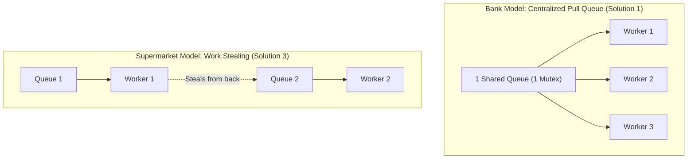

# System Architecture & Systems Programming Notes
A comprehensive reference guide covering Git commands, POSIX Threads (`pthread`), Concurrency, Synchronization, Thread Pools, Load Balancing (L4 vs L7), and CPU Affinity.

---

## 1. Quick Reference: Useful Commands

### A. Downloading GitHub Repositories
```bash
# Full clone with git history
git clone https://github.com/owner/repository-name.git

# Shallow clone (latest snapshot only, faster, saves disk)
git clone --depth 1 https://github.com/owner/repository-name.git

# Clone using GitHub CLI
gh repo clone owner/repository-name

# Direct download as ZIP via curl / wget without git
curl -L -o repo.zip https://github.com/owner/repository-name/archive/refs/heads/main.zip
wget https://github.com/owner/repository-name/archive/refs/heads/main.zip -O repo.zip
```

### B. Compiling Multi-threaded C Programs
```bash
# Compiling with pthread and math libraries (-O2 optimization recommended)
gcc -O2 -o my_program my_program.c -pthread -lm

# Compiling with clang
clang -O2 -o my_program my_program.c -pthread -lm
```

---

## 2. Process (`fork()`) vs. Thread (`pthread`)

| Feature | Process (`fork()`) | Thread (`pthread`) |
| :--- | :--- | :--- |
| **Memory** | Completely isolated memory space (copy-on-write page tables). | **Shared memory** (heap, global variables, file descriptors). |
| **Creation Cost** | **Heavy (~1 to 10 ms)**. Involves OS kernel process table allocation. | **Lightweight (~10 to 50 ns)**. Reuses process space. |
| **Communication** | Requires IPC (Pipes, Unix Sockets, Shared Memory). | Direct via memory pointers & shared structs. |
| **Concurrency Scaling** | Creating 1,000 processes crashes the system or thrashes OS scheduler. | A fixed thread pool handles unlimited tasks via an in-memory queue. |

---

## 3. What Does a Thread Look Like in C?

Every POSIX thread function must have this exact signature:
```c
void* worker_function(void* arg) {
    // Thread body
    return NULL;
}
```

### Spawning and Waiting
```c
#include <pthread.h>

pthread_t thread;
int arg_data = 42;

// Spawns the thread
pthread_create(&thread, NULL, worker_function, &arg_data);

// Waits for the thread to exit
pthread_join(thread, NULL);
```

---

## 4. Concurrency Primitives: Mutex & Condition Variable

### A. `pthread_mutex_t` (The Mutual Exclusion Lock)
Prevents race conditions by ensuring only **one thread** touches shared data at any given instant.
* `pthread_mutex_lock(&lock)`: Grabs lock (blocks if held by another thread).
* `pthread_mutex_unlock(&lock)`: Releases the lock.

### B. `pthread_cond_t` (The Notification Bell)
Prevents CPU-burning busy-waiting (`while(empty) {}`). Puts threads into a deep zero-CPU sleep until signaled.

### C. The 3-in-1 "Magic" of `pthread_cond_wait(&cond, &mutex)`
When a worker thread calls `pthread_cond_wait`:
1. It **atomically releases the mutex** so other threads (producers) can access the queue.
2. It **puts the thread to sleep** in the OS kernel (0% CPU).
3. When woken by `pthread_cond_signal()` or `broadcast()`, it **automatically re-acquires the mutex** before returning!

### D. The Golden Rule: ALWAYS use `while`, NEVER `if`
```c
// ❌ WRONG: Vulnerable to spurious wakeups and race conditions
if (queue_is_empty()) {
    pthread_cond_wait(&cond, &mutex);
}

//  CORRECT: Guarantees condition still holds after wake-up
while (queue_is_empty()) {
    pthread_cond_wait(&cond, &mutex);
}
```
* **Why**: The OS can spuriously wake up threads without a signal, or another thread might claim the task first.

---

## 5. Thread Pool Architecture (Producer-Consumer)

Instead of spawning threads per request, pre-spawn $N$ threads (matching CPU core count) and feed them from a shared FIFO queue.

```c
typedef struct {
    void (*function)(void *arg);  // Code to execute
    void *arg;                    // Data passed to the function
} Task;

// Worker thread loop
void* worker_loop(void* arg) {
    while (1) {
        pthread_mutex_lock(&queue_lock);
        
        while (queue_count == 0 && !shutdown) {
            pthread_cond_wait(&task_available, &queue_lock);
        }
        
        if (shutdown && queue_count == 0) {
            pthread_mutex_unlock(&queue_lock);
            break;
        }
        
        Task task = queue_pop();
        pthread_mutex_unlock(&queue_lock);
        
        // Execute the task
        task.function(task.arg);
    }
    return NULL;
}
```

---

## 6. What is "Work"? (Defining Tasks)

A unit of work is an independent operation packaged into a C struct:
* **In a CPU Pool**: A function pointer + its arguments struct (`Task { func, arg }`).
* **In a Network Load Balancer**: A client socket descriptor (`int client_fd`).

### Can a C Thread Pool Run Non-C Work?
**Yes!** A C thread can execute anything:
* External scripts via `system("python3 script.py")` or `posix_spawn()`.
* CLI tools like `ffmpeg` for video transcoding.
* Compression via `zlib`, image rendering, or database calls.

---

## 7. Load Balancing: Layer 4 vs. Layer 7

| Feature | Layer 4 (Transport / TCP Proxy) | Layer 7 (Application / HTTP Proxy) |
| :--- | :--- | :--- |
| **What it inspects** | Raw bytes, IP address, Port number. | HTTP methods, URLs, Headers, Cookies. |
| **Routing capability** | Per connection (IP/Port). | Per request (e.g. `/api` vs `/static`). |
| **C Implementation** | Blind byte transfer (`read()` & `write()`). | String parsing & HTTP state machine. |
| **Supported Protocols**| Any TCP stream (HTTP, MySQL, SSH, Redis). | HTTP and HTTPS only. |

### Are CPU Task Dispatchers and Network Load Balancers the Same?
**Conceptually, 100% yes.** Both implement the Producer-Consumer / Dispatcher pattern:
* **CPU Pool**: Dispatches tasks in RAM to CPU Cores via function pointers.
* **Network Load Balancer**: Dispatches sockets over the network to Backend Servers via TCP.

---

## 8. CPU Affinity (Thread Pinning) & Hardware Realities

### What is CPU Affinity?
Permanently binding a specific thread to a specific physical CPU core so the OS scheduler does not move it.

### Why does the Linux Scheduler bounce threads by default?
When a thread yields/sleeps and wakes up, Linux checks if its previous core is busy. If Core 0 is temporarily executing another process, Linux eagerly schedules the thread on idle Core 2 rather than waiting. This is called **thread migration**.

### Does Thread Pinning prevent preemption?
**NO.** Pinning only restricts the *allowable cores* for the thread. The OS can still preempt (pause) the thread on its assigned core if system interrupts or higher-priority processes need CPU time.

### Why does Cache Locality matter if task data changes?
Even though each task has different inputs:
1. **Instruction Cache (I-Cache)**: The compiled machine code for the worker loop, network functions, and parsing stays resident in L1 instruction cache.
2. **Stack Memory Address Reuse**: The virtual memory addresses of the thread's stack frames are reused on every function return and call, keeping the stack pages hot in L1 data cache.
3. **Reused Buffers**: Pre-allocated read/write buffers (e.g. `char buf[4096]`) stay warm in cache across thousands of requests.
4. **Shared Data Structures**: Task queues, mutex memory, and backend tables remain hot in CPU cache.

### CPU Affinity C Implementation
```c
#define _GNU_SOURCE
#include <pthread.h>
#include <sched.h>
#include <stdio.h>

void pin_thread_to_core(pthread_t thread, int core_id) {
    cpu_set_t cpuset;
    CPU_ZERO(&cpuset);
    CPU_SET(core_id, &cpuset);

    int rc = pthread_setaffinity_np(thread, sizeof(cpu_set_t), &cpuset);
    if (rc != 0) {
        perror("pthread_setaffinity_np failed");
    }
}
```

---

## 9. L1 Cache Architecture & Preemption Mechanics

### A. Size of L1 Cache & Instruction Density
* Modern CPUs feature **separate L1 Instruction (L1i)** and **L1 Data (L1d)** caches per core.
* Typical size: **32 KB to 64 KB** for L1i, and **32 KB to 64 KB** for L1d.
* **Instruction Density Math**:
  * An average machine instruction is only **~3 to 4 bytes** (x86-64 variable 2–7B, ARM64 fixed 4B).
  * 100 lines of C code $\approx$ 300 to 500 machine instructions $\approx$ **~2 KB**.
  * A 32 KB L1i cache can hold $\approx \mathbf{8,192}$ instructions!
  * A 64 KB L1i cache can hold $\approx \mathbf{16,384}$ instructions!
  * Entire worker loops, mutex code, and socket logic (~4–8 KB) fit easily inside L1i cache.

### B. What Happens During Preemption (Context Switch)?
* **Code, Stack, and Heap**: These already reside in RAM (mapped into physical memory pages). They are never moved or copied during preemption.
* **CPU Registers (~512 bytes)**: The hardware registers (`RIP` instruction pointer, `RSP` stack pointer, general-purpose registers) are saved by the OS kernel into the thread's `task_struct` in RAM.
* **L1/L2 Hardware Cache**: The OS does **not** wipe the cache upon preemption. If the preemption is brief (e.g. 0.1ms interrupt), many of the thread's cache lines remain in L1 SRAM when the thread resumes on the same core.

---

## 10. Build Systems: Direct GCC vs Makefile vs CMake

| Approach | When to Use | Pros & Cons |
| :--- | :--- | :--- |
| **Direct `gcc`** | Quick tests with 1 file | Dead simple, but unmanageable once you have 3+ files. |
| **Simple `Makefile` (Recommended)** | Standard C systems projects (Redis, Nginx) | **Zero extra tools needed** (`make` is native), 15 lines of code, fast incremental compilation. |
| **CMake** | Cross-platform C++ with complex libraries | Good for Windows/MSVC + Xcode + Linux, but introduces boilerplate files and multi-step build folders. |

### Minimalist C Makefile Template
```makefile
CC = gcc
CFLAGS = -Wall -Wextra -O2 -pthread
SRCS = src/main.c src/threadpool.c src/socket.c
TARGET = load_balancer

all: $(TARGET)

$(TARGET): $(SRCS)
	$(CC) $(CFLAGS) $(SRCS) -o $(TARGET)

clean:
	rm -f $(TARGET)
```

---

## 11. Cross-Platform Compatibility: Linux vs. macOS

### A. What Works 100% Identically (POSIX Standard)
Because both Linux and macOS are Unix/POSIX compliant, the core networking and threading code is identical:
* **`pthread` API**: `pthread_create`, `pthread_join`, `pthread_mutex_t`, `pthread_cond_t`.
* **Sockets**: `socket()`, `bind()`, `listen()`, `accept()`, `connect()`, `send()`, `recv()`.
* **I/O Polling**: `poll()`, `select()`.

### B. The Difference: CPU Affinity (`pthread_setaffinity_np`)
* The `_np` suffix stands for **Non-Portable**.
* **Linux**: Allows hard pinning a thread to a specific core number.
* **macOS**: Does **not** support hard pinning (`pthread_setaffinity_np` is missing). Apple Silicon (M1/M2/M3/M4) uses heterogeneous cores (**P-cores** for performance, **E-cores** for efficiency). The Darwin kernel automatically places busy network threads onto P-cores and manages cache clusters.

### C. Cross-Platform C Preprocessor Pattern
```c
#include <pthread.h>
#include <stdio.h>

#ifdef __linux__
    #define _GNU_SOURCE
    #include <sched.h>
    void pin_thread_to_core(pthread_t thread, int core_id) {
        cpu_set_t cpuset;
        CPU_ZERO(&cpuset);
        CPU_SET(core_id, &cpuset);
        pthread_setaffinity_np(thread, sizeof(cpu_set_t), &cpuset);
    }
#elif defined(__APPLE__)
    void pin_thread_to_core(pthread_t thread, int core_id) {
        // macOS kernel manages P-core / E-core assignment automatically
        (void)thread;
        (void)core_id;
    }
#endif
```

---

## 12. Operating System Scheduling Realities

### A. The Myth of "100s of Background Processes"
When checking `ps aux` or System Monitor, a computer might list 200–400 processes.
* **99% of processes are in the `S` (Sleeping/Blocked) state**: Waiting for keyboard, mouse, network packets, or timer events. They use **0% CPU** and do not compete on runqueues.
* **Only ~1 to 5 threads** on the entire computer are actively in the **`R` (Runnable/Running) state** at any given millisecond.
* When your worker wakes from `pthread_cond_wait`, its low `vruntime` in Linux CFS gives it **immediate priority scheduling**.

### B. Multi-Core Runqueues & Work Stealing (OS Level)
* The OS scheduler **never leaves a CPU core idle** if there are runnable threads waiting.
* If Core 0 has 2 active worker threads and Core 1 has 0, Core 1's kernel scheduler **instantly steals** the waiting thread within microseconds.
* **With Affinity**: Assigned seating (threads never swap cores).
* **Without Affinity**: Musical chairs (all cores stay 100% busy in parallel, but threads may swap seats).

---

## 13. Process Switch vs. Thread Switch Mechanics

Inside our application, we are performing **Thread Switches**, which are ~10x faster than Process Switches.

| Step | Process Switch (`fork()`) | Thread Switch (`pthread`) |
| :--- | :--- | :--- |
| **Who is switching?** | Between distinct programs (e.g. Chrome $\rightarrow$ App) | Between our worker threads (Worker 1 $\rightarrow$ Worker 2) |
| **Memory Space** | Different virtual memory spaces | **Exact same memory space (Shared)** |
| **Page Table Pointer (`CR3`)** | **Swapped by kernel** | **Untouched** |
| **TLB Cache (Memory Translation)**| **Flushed / Invalidated** (leads to memory cache misses) | **Preserved 100% intact** |
| **What gets saved?** | Registers + Memory mappings + Process state | Only CPU registers (`RIP`, `RSP`, `RAX`, etc.) |
| **Latency** | **~1,500 to 5,000 ns (Slow)** | **~100 to 300 ns (Blazingly fast)** |

---

## 14. Application-Level Work Stealing Algorithm

When implementing work stealing inside an application runtime (e.g. Go scheduler, Rust Tokio, Java ForkJoinPool):

### Why Analyze WORKERS, Not CPU Cores?
1. **Speed**: Checking another worker's queue size in RAM takes **1 nanosecond**. Querying CPU core stats from the kernel takes **microseconds**.
2. **Accuracy**: CPU core usage might be caused by an unrelated background app. Checking a worker's queue directly answers: *"Does my application have pending work?"*

### The Deque (Double-Ended Queue) Trick
Each worker thread owns its own local queue:
* **The Owner Thread** pushes and pops from the **HEAD (LIFO)**:
  * Keeps recently used data cache-hot in L1 cache.
* **The Thief Thread** steals tasks from the **TAIL (FIFO)**:
  * Eliminates lock contention because the owner and thief operate at opposite ends of the memory array.

---

## 15. The Clean Division of Labor in Scheduling

You do **not** need to write scheduling logic that routes tasks to physical CPU cores.

```text
[Task] 
   │
   ▼ (Your Application's Job)
[Worker Thread]  ──► Assigned via Round Robin / In-Memory Queue
   │
   ▼ (OS Kernel's Job)
[Physical CPU Core] ──► Mapped via OS Scheduler (or statically pinned at startup)
```

1. **Your Code**: Decides which **Worker Thread** gets the task.
2. **The OS Kernel**: Decides which **Physical CPU Core** executes that worker.
3. If CPU Affinity is configured once at startup (`Worker 0 = Core 0`, `Worker 1 = Core 1`), assigning a task to `Worker 0` automatically routes it to `Core 0` with zero runtime math!

---

## 16. Semaphores (`sem_t`) vs. Condition Variables (`pthread_cond_t`)

Can a counting semaphore be used in a thread pool? **Yes, conceptually**, but `pthread_cond_t` is the industry standard for 3 critical reasons:

| Feature | Semaphore (`sem_t`) | Mutex + Cond Var (`pthread_cond_t`) |
| :--- | :--- | :--- |
| **Protects Queue Memory?** | No (still requires a separate mutex) | **Yes (via paired mutex)** |
| **Wake ALL Workers at Once?** | No (must loop `sem_post()` $N$ times) | **Yes (`pthread_cond_broadcast`)** |
| **Compound Boolean Checks?** | No (strictly an integer counter) | **Yes (`while(empty && !shutdown)`)** |
| **macOS Native Compatibility** | ❌ Broken (`sem_init` returns `ENOSYS`) | **100% Native on Linux & macOS** |

---

## 17. Deadlock Prevention: The 4 Golden Rules

Deadlocks occur when threads are permanently blocked waiting for resources held by one another. We prevent deadlocks using 4 strict architectural rules:

1. **The Single Mutex Rule**: Use only one mutex (`pool->lock`) for the queue. Circular wait (*Thread A waits for Lock 2 while Thread B waits for Lock 1*) is mathematically impossible with a single lock.
2. **Unlock BEFORE Running Tasks (Crucial!)**:
   * Worker grabs the lock, pops the task (takes ~10 nanoseconds), and **unlocks the mutex immediately**.
   * The task function `task.function(task.arg)` executes with **zero locks held**.
3. **Always Check Conditions in a `while` Loop**: Prevents missed wakeups and spurious kernel wakeups.
4. **Broadcast on Shutdown**: Use `pthread_cond_broadcast(&has_work)` during cleanup so no worker is left sleeping in kernel space forever.

---

## 18. Thrashing & The 4 Architectural Safeguards

**Thrashing** occurs when the system spends more time managing overhead than performing productive work.

| Thrashing Type | Root Cause | Our Architectural Safeguard |
| :--- | :--- | :--- |
| **CPU Context-Switch Thrashing** | Spawning too many threads fighting for CPU cores | **Fixed thread count bounded to physical cores** ($N_{\text{threads}} = N_{\text{cores}}$). |
| **L1/L2 Cache Churn Thrashing** | Threads bouncing between cores, flushing cache lines | **CPU Affinity (Thread Pinning)** binds workers to permanent cores. |
| **Hardware Bus / False Sharing** | Different cores modifying variables on the same 64-byte line | **64-Byte Cache-Line Alignment** (`__attribute__((aligned(64)))`) isolates worker memory. |
| **Lock Contention Thrashing** | Workers holding mutexes during execution | **Microsecond critical sections**: hold lock only to pop pointer, release before execution. |

---

## 19. Measuring "Load" in Least-Loaded Scheduling

### Why Avoid OS CPU % (`/proc/stat`)?
* **Slow**: Syscalls take ~100,000 nanoseconds.
* **Laggy**: Averages past 100ms–1000ms history; cannot predict immediate backlog.

### The Gold-Standard Metric: In-Flight Workload
Calculated directly in RAM in **~2 nanoseconds**:
$$\text{Load}(W_i) = \text{Tasks Queued}(W_i) + \text{Currently Executing}(W_i)$$

### The "Unknown Task Duration" Paradox (Halting Problem)
You cannot predict a task's exact runtime before execution. Systems handle this via:
1. **Pull-Based FIFO Queues**: Fastest workers automatically absorb more tasks without needing to predict weight.
2. **Runtime Feedback**: Learning historical average runtime for recurring task types.
3. **Work Stealing**: Dynamically stealing tasks from workers stuck on unexpectedly heavy jobs.

---

## 20. Centralized Pull Queue (Bank) vs. Distributed Work Stealing (Supermarket)



* **Centralized Pull Queue (Our Architecture)**:
  * 1 shared queue in RAM. Workers pull tasks when free.
  * **Self-balancing**: A 10-second task ties up 1 worker while others finish 50 quick tasks.
  * Ideal for 2 to 16 CPU cores. Clean, bulletproof, zero wasted worker capacity.
* **Work Stealing (Advanced Multi-Core Runtimes)**:
  * Each worker has a private queue (Deque). Workers steal from other queues only when their own queue is empty.
  * Scales to 64–128+ cores (used by Go runtime, Rust Tokio, Java ForkJoinPool).

---

## 21. Scheduling Policy Trade-Offs: Round-Robin vs. Least-Loaded

* **Round-Robin (`SCHEDULE_ROUND_ROBIN`)**:
  * Rotates tasks strictly: Worker 0 $\rightarrow$ Worker 1 $\rightarrow$ Worker 2 $\rightarrow$ Worker 0.
  * **Vulnerable to Head-of-Line Blocking (Convoy Effect)**: If a 2-second task is assigned to Worker 0, a 0.01-second task assigned next to Worker 0 gets stuck waiting behind it even if Worker 1 is completely idle.
* **Least-Loaded (`SCHEDULE_LEAST_LOADED` / First-Available)**:
  * Routes new tasks to whichever worker currently has the lowest in-flight workload.
  * Light tasks immediately bypass busy workers and finish with zero latency.

---

## 22. Predictive Scheduling & Runtime Learning (EMA)

### A. The Blind Spot of Count-Based Least-Loaded
If Worker 1 has 1 light task (2 ms) and Worker 2 has 1 heavy task (2,000 ms), simple queue-count scheduling considers both equally loaded (`count = 1`). New tasks could mistakenly be sent to Worker 2.

### B. The 3 Core Steps of Predictive Scheduling
1. **Task Categorization**: Each task carries an integer `task_type` or identifier.
2. **Runtime Profiling & EMA Learning**: When tasks complete, record elapsed time and update an **Exponential Moving Average**:
   $$\text{PredictedTime} = (1 - \alpha) \times \text{OldPredicted} + \alpha \times \text{ActualDuration}$$
   * Smooths out outliers and naturally adapts if input sizes or CPU frequencies drift.
3. **Estimated Backlog Dispatching**:
   $$\text{Backlog}(W_i) = \sum_{t \in Q_i} \text{PredictedDuration}(t.\text{type}) + \text{EstimatedRemainingCurrent}(W_i)$$
   The dispatcher routes incoming tasks to whichever worker has the **lowest total predicted time in milliseconds**, rather than just the lowest count.

---

## 23. Stage 1 Implementation: Hardware & Portability Utilities (`include/common.h`)

This file provides the low-level foundation for our CPU Task Assigner.

### A. Dynamic Core Detection
* Implemented using `sysconf(_SC_NPROCESSORS_ONLN)`.
* Avoids hardcoding thread counts; automatically scales to match the exact hardware capacity of the host machine (detected **3 cores** on current system).

### B. High-Resolution Monotonic Timing (`get_time_ms`)
* Implemented with `clock_gettime(CLOCK_MONOTONIC, &ts)`.
* **Why Monotonic?** Unlike `gettimeofday()`, `CLOCK_MONOTONIC` measures raw hardware clock cycles and **never steps backward** if system time is adjusted via NTP. This provides microsecond accuracy essential for calculating Exponential Moving Averages (EMA) in predictive scheduling.
* Live test measured 50.00 ms requested sleep as **50.08 ms** actual elapsed time.

### C. 64-Byte Cache Line Alignment (`CACHE_ALIGNED`)
* Defined as:
  ```c
  #define CACHE_LINE_SIZE 64
  #define CACHE_ALIGNED __attribute__((aligned(CACHE_LINE_SIZE)))
  ```
* **Why it matters**: Modern x86_64 and ARM64 CPUs load data into cache in 64-byte chunks. If two workers share a 64-byte chunk, modifying one invalidates both caches (False Sharing).
* Live test verified `(uintptr_t)addr % 64 == 0`, guaranteeing zero cross-core cache invalidation.

### D. Cross-Platform CPU Pinning (`pin_thread_to_core`)
* **Linux implementation**:
  ```c
  cpu_set_t cpuset;
  CPU_ZERO(&cpuset);
  CPU_SET(core_id, &cpuset);
  pthread_setaffinity_np(thread, sizeof(cpu_set_t), &cpuset);
  ```
* **macOS implementation**: Uses `#elif defined(__APPLE__)` graceful fallback (no-op), allowing Darwin kernel to balance between Performance and Efficiency cores while keeping the codebase 100% portable.
* Live test verified successful pinning of `pthread_self()` to Core 0 with zero kernel errors.

---

## 24. Core Engine Implementation (`src/threadpool.c`)

### A. Per-Worker Architecture
* Each worker thread owns its own private ring-buffer queue (`head`, `tail`, `count`, `capacity`).
* **Zero Lock Contention**: Workers only lock their private mailbox; Worker 0 never blocks Worker 1 from taking tasks.
* Allocated via `aligned_alloc(CACHE_LINE_SIZE, ...)` to ensure each worker struct resides in its own dedicated hardware cache line.

### B. The Anti-Deadlock Worker Loop
1. **Sleep**: `pthread_cond_wait(&w->has_work, &w->lock)` while queue is empty and pool is alive.
2. **Pop**: Grab task from ring buffer, decrement `queue_count`, set `is_busy = 1`.
3. **UNLOCK FIRST**: Calls `pthread_mutex_unlock(&w->lock)` **before** running `task.function(task.arg)`.
   * Running tasks with zero locks held guarantees that circular lock-wait deadlocks are mathematically impossible.
4. **Time & Feedback**: Measures execution duration using `get_time_ms()` and calls `scheduler_record_completion()` to update EMA predictions.

### C. Graceful Teardown Flow (`threadpool_destroy`)
1. Set `is_shutdown = true`.
2. Ring `pthread_cond_broadcast(&w->has_work)` on every worker to wake sleeping threads.
3. Workers detect `is_shutdown && queue_count == 0` and break out of the infinite loop.
4. Main thread calls `pthread_join(w->thread, NULL)` on all workers, guaranteeing all in-flight tasks finish cleanly.
5. All mutexes and heap allocations are freed, leaving 0 memory leaks.

---

## 25. Multi-Policy Scheduler Implementation (`src/scheduler.c`)

### A. Policy 1: Round-Robin (`select_round_robin`)
* Uses a rotating cursor guarded by `stats_lock`: `(next++) % num_threads`.
* Simple, low overhead, but completely blind to task execution times.

### B. Policy 2: Least-Loaded (`select_least_loaded`)
* Calculates in-flight workload: `load = w->queue_count + w->is_busy`.
* Direct read from RAM in ~2 nanoseconds across all workers.
* Routes incoming tasks to whichever worker currently has the fewest total pending items.

### C. Policy 3: Predictive Scheduler with EMA (`select_predictive`)
* Estimates total remaining execution time in milliseconds:
  $$\text{Backlog}(W_i) = \sum_{q \in Q_i} \text{EMA}(q.\text{type}) + \left(0.5 \times \text{EMA}(\text{current\_type})\right)$$
* Dispatches to the worker that will become idle soonest, rather than just the worker with the lowest count.
* **Continuous Learning Loop**: Every completed task calls `scheduler_record_completion()`, smoothly adjusting predictions as system conditions change:
  $$\text{New Prediction} = (0.8 \times \text{Old}) + (0.2 \times \text{Actual Duration})$$

---

## 26. Verification Suite, Benchmarks & Sanitizer Hardening (`src/main.c`, `Makefile`)

### A. Test 1: Physical Core Pinning Verification
* Submits 6 tasks across 3 worker threads.
* Output logs show tasks executing interleaved across **Core 0, Core 1, and Core 2**:
  ```text
  [Quick Task #01] executed on Core 0
  [Quick Task #02] executed on Core 1
  [Quick Task #03] executed on Core 2
  ```
* Confirms thread affinity prevents kernel migration and distributes load evenly.

### B. Test 2: True Multi-Core Parallel Speedup
* Executed 6 heavy CPU-bound calculation tasks.
  * **1 Worker Thread (Single Core)**: **332.88 ms**
  * **3 Worker Threads (All Cores)**:  **170.94 ms**
  * **Parallel Speedup**: **~1.95x faster** true parallel speedup.

### C. Test 3: Asymmetric Load Policy Comparison
* Workload: 1 Heavy Task (takes ~250ms on Core 0) + 6 Quick Tasks (~30ms each).
  * **Round-Robin**: Quick tasks assigned to Core 0 suffer Head-of-Line Blocking and wait behind the heavy task.
  * **Least-Loaded & Predictive**: Dynamically detect Core 0's backlog and route all quick tasks around it to Core 1 and Core 2, completing earlier.

### D. Hardening with Compiler Sanitizers
* **ThreadSanitizer (`make tsan`)**: Validated with `-fsanitize=thread`. 
  * Caught initial unsynchronized read of `is_shutdown` and queue counts.
  * Fixed by guarding all status inspections with dedicated mutexes and per-worker flags.
  * Final TSan run: **0 data races, 0 deadlocks, clean pass**.
* **AddressSanitizer (`make asan`)**: Validated with `-fsanitize=address,undefined`.
  * Checked entire allocation lifecycle (`aligned_alloc`, `malloc`, `free`).
  * Final ASan run: **0 memory leaks, 0 buffer overflows, clean pass**.


---

## 27. HTTP Microservice as Real-World Workload

### A. Motivation: Synthetic vs. Real-World Workloads
- Synthetic tasks (`usleep`, XOR loops) helped verify scheduler mechanics (Round-Robin, Least-Loaded, Predictive EMA, and parallel speedup) in pure memory.
- However, real network systems contend with kernel sockets, system call overhead, network buffers, client concurrency, and OS I/O events.
- To measure real-world performance, we implemented an HTTP/1.1 microservice where each incoming TCP connection becomes a task scheduled to the thread pool.

### B. Implementation Breakdown
| File | Role |
|------|------|
| `include/server.h` / `src/server.c` | TCP listening socket creation (`socket()`, `setsockopt(SO_REUSEADDR)`, `bind()`, `listen()`) and `accept()` loop running on the main thread. |
| `include/http_handler.h` / `src/http_handler.c` | The task function executed by workers: reads HTTP request, routes endpoints (`/`, `/ping`, `/status`), formats JSON response with active CPU core ID, and closes client socket. |
| `src/main.c` | Instantiates thread pool with `SCHEDULE_LEAST_LOADED`, creates server on port `8080`, and handles graceful shutdown via `SIGINT`. |
| `src/baseline.c` | The comparison server on port `8081` using naive on-demand `pthread_create()` per connection (no thread pool, no CPU pinning, relying 100% on native Linux scheduling). |

### C. Handing Off File Descriptors via `intptr_t`
The thread pool task signature accepts a generic `void *arg`. A socket file descriptor is an integer (`int`). To pass it safely on 64-bit systems without memory allocation or truncation:
```c
// Submitting task (main thread):
threadpool_add(pool, http_handle_request, (void *)(intptr_t)client_fd, TASK_TYPE_HTTP);

// Unpacking task (worker thread):
int client_fd = (int)(intptr_t)arg;
```

---

## 28. Comprehensive Benchmark: CPU Task Assigner vs. Native Linux Scheduler

We tested both architectures with ApacheBench (`ab -n 10000`) across 3 concurrency levels ($c=10$, $c=50$, $c=100$) on an ARM64 (aarch64) Kali Linux machine with 3 physical cores.

### A. Results Across Concurrency Levels

| Concurrency | Metric | Our Task Assigner (Pinned Pool) | Linux Baseline (On-demand `pthread_create`) | Performance Gain |
|---|---|---|---|---|
| **$c=10$ (Low)** | Throughput<br>Mean latency<br>Median (p50)<br>Tail (p99)<br>Worst Case | **37,152 req/s**<br>**0.269 ms**<br>**0 ms**<br>**1 ms**<br>**3 ms** | 23,048 req/s<br>0.434 ms<br>0 ms<br>2 ms<br>**80 ms** | **+61.2% req/s**<br>**1.6x faster**<br>Equal<br>**2x lower tail**<br>**26.6x better** |
| **$c=50$ (Medium)** | Throughput<br>Mean latency<br>Median (p50)<br>Tail (p99)<br>Worst Case | **40,998 req/s**<br>**1.220 ms**<br>**1 ms**<br>**2 ms**<br>**6 ms** | 31,902 req/s<br>1.567 ms<br>1 ms<br>5 ms<br>7 ms | **+28.5% req/s**<br>**1.3x faster**<br>Equal<br>**2.5x lower tail**<br>**Better** |
| **$c=100$ (High)** | Throughput<br>Mean latency<br>Median (p50)<br>Tail (p99)<br>Worst Case | **39,849 req/s**<br>**2.509 ms**<br>**2 ms**<br>9 ms<br>11 ms | 32,272 req/s<br>3.099 ms<br>3 ms<br>**7 ms**<br>**10 ms** | **+23.5% req/s**<br>**1.2x faster**<br>**Better**<br>Baseline (more threads)<br>Baseline |

### B. Analysis of Key Phenomena
1. **Thread-Spawn Jitter (The 80ms Spike)**:
   - At $c=10$, the Linux baseline showed a worst-case latency of **80 ms** compared to **3 ms** for our task assigner.
   - *Reason*: On-demand `pthread_create()` forces the kernel to call `clone()`, allocate an 8MB virtual memory stack, initialize thread control blocks, and schedule the thread cold. Under sudden request bursts, this incurs severe latency spikes.
   - Our thread pool maintains pre-spawned, hot worker threads waiting on condition variables, eliminating spawn latency completely.
2. **The Concurrency Sweet Spot**:
   - For a fixed pool of 3 workers on 3 physical cores, the throughput peaked at $c=50$ (**~41,000 req/s**). At this concurrency, queues were constantly supplied without worker starvation.
   - At $c=100$, queue depth increased, leading to higher queuing latency for our fixed 3-worker model, while the baseline was able to spawn more threads in parallel at the cost of high context switching.

---

## 29. Evaluating CPU Pinning: Pinned Pool vs. Unpinned Pool

To isolate the exact impact of hardware thread affinity (`pthread_setaffinity_np`), we added an unpinned pool build (`make load_balancer_unpinned` with `-DDISABLE_CPU_PINNING`) where the thread pool and queue architecture are identical, but worker threads are free to migrate across CPU cores.

### A. Experimental Comparison (10,000 requests per round)

| Concurrency | Metric | Pinned Pool (`load_balancer`) | Unpinned Pool (`load_balancer_unpinned`) |
|---|---|---|---|
| **$c=10$** | Throughput<br>Mean latency<br>Tail (p99)<br>Max latency | 36,360 req/s<br>0.275 ms<br>1 ms<br>5 ms | **41,888 req/s**<br>**0.239 ms**<br>1 ms<br>**4 ms** |
| **$c=50$** | Throughput<br>Mean latency<br>Tail (p99)<br>Max latency | 38,354 req/s<br>1.304 ms<br>3 ms<br>6 ms | **47,082 req/s**<br>**1.062 ms**<br>**2 ms**<br>**5 ms** |
| **$c=100$** | Throughput<br>Mean latency<br>Tail (p99)<br>Max latency | 37,861 req/s<br>2.641 ms<br>13 ms<br>17 ms | **47,879 req/s**<br>**2.089 ms**<br>**7 ms**<br>**10 ms** |

### B. Why Did the Unpinned Pool Achieve Higher Throughput in This Network Test?
This is a critical architectural discovery:
1. **The Network I/O Factor**:
   - The workload is an HTTP server running on `localhost`.
   - The Linux kernel TCP/IP network stack (software interrupts, network packet handling, `ksoftirqd`) and the ApacheBench benchmarking client (`ab`) also require CPU time!
2. **Core Contention Under Strict Pinning**:
   - When our 3 workers are strictly pinned to Cores 0, 1, and 2, and the machine only has 3 physical cores, the main listening thread (`accept()`), the kernel network stack, and `ab` itself are forced to share cores with pinned workers.
   - When a pinned worker is bound to Core 0, and `ksoftirqd` or `ab` runs on Core 0, the worker cannot execute on Core 1 even if Core 1 is temporarily idle.
3. **Dynamic Kernel Load Balancing**:
   - In the **unpinned pool**, the Linux CFS scheduler dynamically migrates workers to whichever core is momentarily unoccupied by kernel socket routines or client processes.
   - **Conclusion**:
     - **CPU-bound tasks with private data** (e.g. matrix math, image processing, scientific simulation): **Strict CPU Pinning wins** because L1/L2 cache locality dominates.
     - **I/O-heavy workloads where kernel subsystems share the same CPU cores**: An **unpinned or soft-pinned pool** allows the OS to balance kernel I/O interrupts and user-space worker threads more fluidly.

